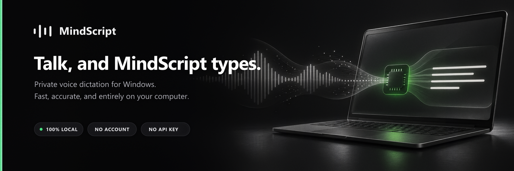
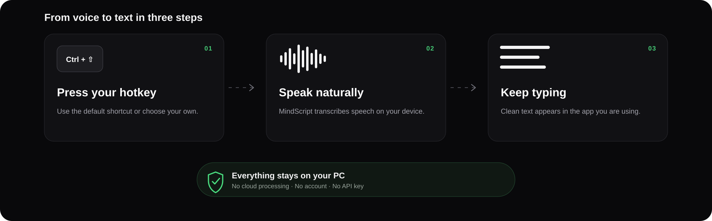
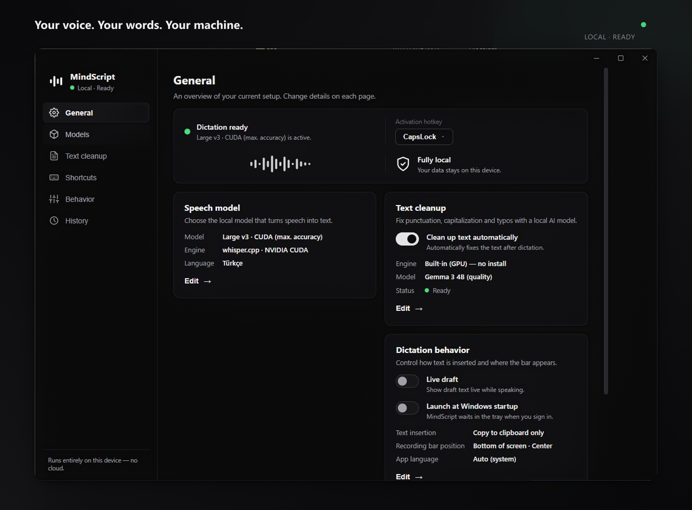

# MindScript

<p align="center">
  
</p>

**Talk, and MindScript types.** A voice dictation app for Windows that runs
entirely on your own computer. Press a hotkey, speak, and the text lands in
whatever app has focus. No cloud, no account, no API key: speech recognition
and text cleanup both run locally, and your audio never leaves the machine.

<p align="center">
  
</p>

## Features

- **Local speech recognition.** Whisper models run through a bundled
  whisper.cpp server on the GPU — CUDA on NVIDIA cards, Vulkan on AMD and
  Intel cards — many times faster than real time. Computers without a
  supported GPU fall back to transformers.js with WebGPU, or the CPU.
- **Live draft.** Optionally shows the transcript in the recording bar while
  you speak; the final text is pasted when you stop.
- **AI text cleanup (optional).** Fixes punctuation, capitalization and typos
  after dictation:
  - **Built-in (GPU):** a small model (Qwen3.5 2B or Gemma 3 4B) runs through a
    bundled llama.cpp GPU server (CUDA or Vulkan). Nothing to install; about 0.1–0.5 s per
    sentence once loaded, and it unloads from GPU memory when idle.
  - **Ollama:** use your own local Ollama server instead.

  The cleanup model is only allowed to proofread. If its reply adds, drops or
  rewrites content (for example answering a dictated question), the original
  transcript is kept.
- **Your choice of models.** A short onboarding suggests a speech model that
  fits your computer; nothing is downloaded until you choose. Add any other
  whisper.cpp or GGUF model from a download link.
- **Repetition cleanup.** Whisper's occasional loops ("hello, hello, hello,
  hello") are collapsed before the text is pasted.
- **Flexible hotkey.** Any key combination, or a single key such as Caps Lock.
  Optionally require holding it for 0.5–2 s, so short presses keep the key's
  normal job (Caps Lock still works as Caps Lock). Hold to talk and release to
  finish, or tap again to finish. Esc cancels a recording.
- **History.** Searchable list of past dictations: copy, paste again or delete.
- **Paste modes.** Auto-paste into the focused app, or copy to the clipboard
  only.
- **Interface** in English, Turkish, German, French, Spanish and Russian;
  follows the Windows light/dark theme.

<p align="center">
  
</p>

## Requirements

- Windows 10 or 11, 64-bit
- A graphics card is recommended for the GPU speech models and built-in
  cleanup: NVIDIA (CUDA), or AMD / Intel (Vulkan, through the regular
  graphics driver). Without one, the WebGPU/CPU speech models still work.
- Internet only for the one-time model downloads

## Installation

Download `MindScript Setup <version>.exe` from the
[Releases page](https://github.com/lutfi0/mindscript/releases) and run it.
MindScript starts in the system tray and opens its settings window.
Nothing is downloaded until you choose a model.

Windows may show a SmartScreen warning ("Windows protected your PC") because
the installer isn't signed with a paid code-signing certificate. Choose
**More info → Run anyway** to install. Updates installed from within the app
don't show this warning.

1. **Get started** page: MindScript checks your graphics card and suggests a
   speech model that fits it. Download the suggestion, or pick another one on
   the **Models** page. The dictation language follows Windows on first start;
   change it at the top of the Models page.
2. Optional, **Text cleanup** page: switch cleanup on, keep the engine on
   *Built-in (GPU)* and download a cleanup model.

The GPU engines (whisper.cpp for the GPU speech models, llama.cpp for
cleanup) are downloaded together with the first model that needs them, in
the build that fits your graphics card (CUDA or Vulkan).

### About the models

The models listed in the app are **suggestions, not requirements**. They are
made by third parties, are independent of MindScript, and come with their
own licenses (see below). You can also add any other compatible model from a
download link, for example from Hugging Face:

- speech: a whisper.cpp **ggml `.bin`** file (runs on the GPU engine),
- text cleanup: a **`.gguf`** file.

Open the file on Hugging Face, copy its download link and paste it under
*Add a model from a link*. Models you add are not checked by MindScript.

## Usage

1. Press `Ctrl+Shift+Space` (or your own hotkey) to start; a recording bar
   appears at the bottom of the screen.
2. Speak.
3. Press the hotkey again to finish; the text is pasted into the focused app.
4. `Esc` cancels the recording.

With a hold time set (Settings → Shortcuts → *Start dictation*), hold the key
until the bar appears, then either keep holding while you speak and let go to
finish, or let go right away and press the key once more to finish.

The tray icon gives quick access to settings, history and "Launch at Windows
startup".

## Privacy

All audio processing and text cleanup happen on your computer. MindScript
connects to the internet only to:

- download models from Hugging Face (once per model),
- download the whisper.cpp and llama.cpp GPU engines from their official
  GitHub releases (once each, only when you pick a GPU speech or built-in
  cleanup model). whisper.cpp publishes no Vulkan build for Windows, so for
  AMD/Intel cards it is built from the official source by this repository's
  [GitHub Actions workflow](.github/workflows/whisper-vulkan.yml) and
  downloaded from this repository's releases,
- check for app updates on GitHub Releases.

Settings, history and models are stored in `%APPDATA%\mindscript\`.

## Building from source

Requires Windows, Node.js 20+ and npm.

```bash
git clone https://github.com/lutfi0/mindscript.git
cd mindscript
npm install
npm run build
npm start
```

`npm run dist` builds the Windows installer into `release/`. If
`cert/mindscript-codesign.pfx` and `cert/password.txt` exist, the build is
code-signed with them; the `cert/` folder is never committed.

Useful flags for development:

```bash
npx electron . --dev-profile          # separate settings/models folder (mindscript-dev)
npm run smoke                         # headless start-up check
npx electron . --engine-test --engine-test-file=<audio.wav> --engine-test-model=<id>
npx electron . --polish-test="raw text to clean up"
```

If Hugging Face is unreachable, set `MINDSCRIPT_HF_MIRROR`
(e.g. `https://hf-mirror.com`) to download models from a mirror.

## Architecture

```
src/
├── main/            main process
│   ├── main.ts          dictation state machine, IPC, app lifecycle
│   ├── engine.ts        speech engine: transformers.js window or whisper.cpp
│   ├── whispercpp.ts    whisper.cpp GPU server lifecycle
│   ├── llamacpp.ts      llama.cpp GPU server + cleanup model downloads
│   ├── polish.ts        text cleanup (built-in engine or Ollama) with guardrails
│   ├── transcript.ts    repetition cleanup
│   ├── models.ts        speech model downloads (with mirror fallback)
│   ├── overlay.ts       transparent, non-focusable recording bar
│   ├── keyhold.ts       hold-to-start hotkey watcher
│   ├── paste.ts         clipboard + Ctrl+V into the target window
│   └── store.ts         settings and history (atomic JSON)
├── preload/         sandboxed contextBridge APIs
├── renderer/        overlay, settings (incl. history) and engine pages
└── shared/          shared types, model catalogs, translations (i18n.ts)
```

The main process compiles to CommonJS (`tsconfig.json`) and the renderer
pages to ES modules (`tsconfig.renderer.json`); `npm run build` runs both.

## Limitations

- Auto-paste does not reach elevated (administrator) windows or some games;
  use "Copy to clipboard only" there.
- While recording, the cancel key (Esc) is captured globally.
- Hold-to-start needs a few seconds after launch before it responds, and it
  does not see the key while an elevated window has focus.
- Windows only (the paste layer and GPU runtimes are Windows-specific).

## Third-party components

MindScript downloads or bundles these components, each under its own license
(models you add from a link carry their own licenses):

| Component | License |
|---|---|
| Electron (with Chromium's bundled licenses) | MIT |
| electron-updater | MIT |
| transformers.js | Apache-2.0 |
| ONNX Runtime Web | MIT |
| whisper.cpp | MIT |
| llama.cpp | MIT |
| OpenAI Whisper models (tiny, base, small) | Apache-2.0 |
| OpenAI Whisper models (large-v3, large-v3-turbo) | MIT |
| Qwen3.5 2B | Apache-2.0 |
| Gemma 3 4B | [Gemma Terms of Use](https://ai.google.dev/gemma/terms) |
| NVIDIA CUDA runtime libraries | NVIDIA CUDA EULA |
| Microsoft Visual C++ runtime (in the whisper.cpp Vulkan build) | Visual Studio redistributable terms |

Models and the GPU runtimes are downloaded by the user from their original
sources and are not part of the installer. The one exception is the
whisper.cpp Vulkan build, which this repository builds and hosts as a
release asset together with whisper.cpp's MIT license. The license texts of the
bundled libraries ship inside the installed app (`LICENSE.electron.txt`,
`LICENSES.chromium.html`, `dist/vendor/`).

## License

[MIT](LICENSE)
